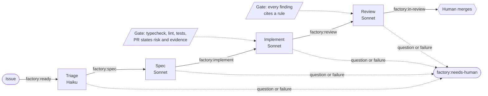
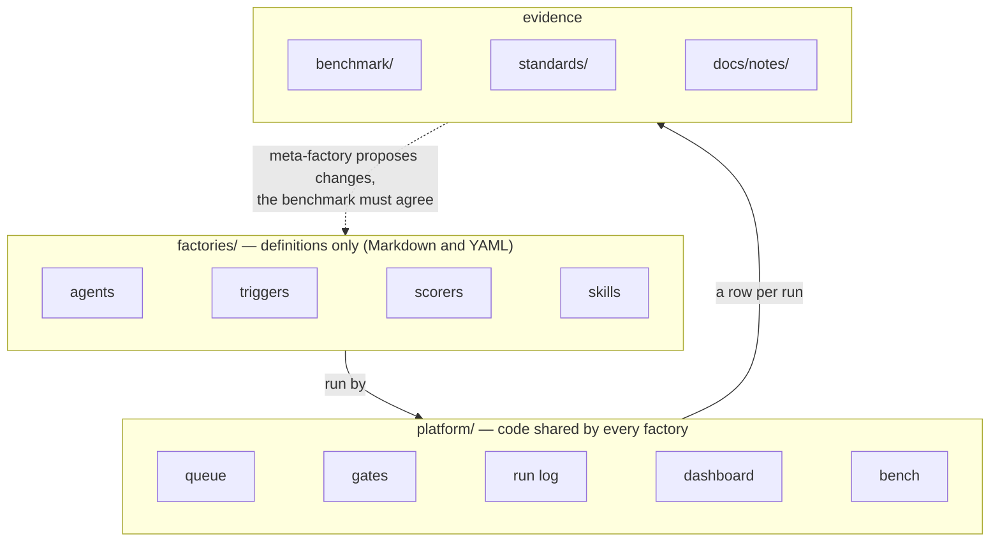

# Factory Platform

A software factory built in the open, one measured stage at a time.

A software factory takes a labelled GitHub issue and returns a reviewed pull request without a person watching. This repository is the factory, the shared platform under it (queue, gates, run log, benchmark), and the record of what each stage cost and changed. It is also its own first customer: every requirement in the plan is a ticket the factory will eventually work.

## How it works

Add `factory:ready` to an issue. Four agents run in turn, each a separate, confined headless Claude Code call on a fresh GitHub Actions runner, and each success adds the label that starts the next.



- **Triage** sizes the work, **spec** plans it, **implement** opens a draft PR, **review** comments on it having seen only the spec and the diff.
- A role that hits a question stops at `factory:needs-human` with a comment. Answer it and re-add the label.
- The factory can open a PR but can never approve or merge one.

## The layers



Creating a factory is copying a directory under `factories/`. Nothing in `platform/` names an agent or a factory.

## Key design decisions

Each is argued in full, with what was rejected, in [`docs/ARCHITECTURE.md`](docs/ARCHITECTURE.md).

| Decision | Why |
| --- | --- |
| **Humans merge.** Two rulesets on `main` and a factory GitHub App with no approve or merge rights. | Automated review is advice. `pnpm check-merge-gate` proves the App is refused. |
| **The queue is GitHub issue labels.** | State is visible in the issue timeline and needs no service to run. |
| **A run is one confined agent.** Temporary clone, OS sandbox, no network, no git or GitHub access; the script commits and opens the PR. | Nobody is there to answer a permission prompt, and the output lands in a public PR. |
| **Guidance plus gates.** Prompts and skills make good output likely; Stop hooks make bad output impossible to hand in. | Hooks run outside the model, so they cannot be talked out of. |
| **The reviewer gets a fresh context.** Only the spec and the diff: no issue thread, no PR description, no transcript. | The author's account of a change should not steer its review. |
| **Review comments become rules.** Human comments are collected weekly; a person promotes each to `standards/rules.md`, and the reviewer must cite them. | The factory learns the repository's habits, but only ones a person chose. |
| **Every run is a row.** Factory, role, model, tokens, cost, wall time, checks, findings, rework. | A change is judged by numbers, and the dashboard is a static page over that table. |
| **Benchmark before belief.** Past issues from this repository, replayed against any factory version and scored. | One good result proves nothing about a prompt, model or gate. |
| **Factories are data.** An agent names a contract (`note`, `spec`, `pull-request`, `review`) that fixes its inputs, gate and output together. | A definition, which the meta-factory may edit, cannot open a PR with no gate. |
| **One idea per stage.** | If two ideas land together, the log cannot tell them apart. |

## Status

| Stage | Idea | |
| --- | --- | --- |
| 1 | One run: one agent, one issue, one PR (TL-4) | built |
| 2 | Gates the agent cannot skip (TL-5) | built |
| 3 | Label queue and human merge gate (TL-6, TL-10) | built |
| 4 | Separate roles, self-explaining PRs, standing rules (TL-7 to TL-9) | built |
| 5 | Run log and dashboard (TL-11 to TL-13) | built |
| 6 | Benchmark, replay harness, scorers (TL-14 to TL-16) | built |
| 7 | Extract: factories as directories on a shared platform (TL-17 to TL-21) | in progress |
| 8 | Meta-factory: proposes factory changes, must beat the benchmark (TL-22 to TL-24) | planned |

The plan with acceptance criteria is [`docs/PLAN.md`](docs/PLAN.md), rendered from [`docs/roadmap.ts`](docs/roadmap.ts) and reconciled against merged PRs by [Throughline](https://github.com/JakobKrzyston/throughline-roadmap). Each stage ends with a note in [`docs/notes/`](docs/notes/): what was expected, what happened, what the numbers said.

## Try it

Needs macOS, Node 22, pnpm, `claude`, `gh` (logged in), `git`, `jq` and `perl`.

```sh
pnpm install
cp .env.example .env.local   # set ANTHROPIC_API_KEY

# run one agent on one issue: triage, spec, implement or review
scripts/run-issue.sh <agent> https://github.com/<owner>/<repo>/issues/<n>

pnpm dashboard                    # cost, time, gate pass rate and rework, from the run log
pnpm bench <factory> <git-ref>    # replay the benchmark against a factory version
pnpm standards collect            # gather last week's human review comments as draft rules
```

To queue work on GitHub Actions instead, run `pnpm queue setup <owner/repo>` once and add `factory:ready` to an issue. [factory-sample](https://github.com/JakobKrzyston/factory-sample) is the practice repository.

## Where things are

| Path | What | Read |
| --- | --- | --- |
| `factories/` | One directory per factory: agents, triggers, scorers, skills | [`factories/README.md`](factories/README.md) |
| `platform/` | Queue, gates, run log, dashboard, bench, scorers, health checks, MCP gateway | [`platform/README.md`](platform/README.md) |
| `benchmark/` | Past issues with expected outcomes | [`benchmark/README.md`](benchmark/README.md) |
| `standards/` | Rules the review agent applies | [`standards/README.md`](standards/README.md) |
| `scripts/` | `run-issue.sh` and the other one-command entry points | |
| `docs/` | Roadmap, plan, architecture, stage notes | |

## Credits

The engineering discipline (domain language, specs, gates before accelerators, review as the brakes) follows Matt Pocock's *Software Factories for Real Engineers* and his [skills](https://github.com/mattpocock/skills). The factory-as-files layout and the measurement loop follow Warp's [Factories](https://docs.warp.dev/factories/) and their [examples](https://github.com/warpdotdev/warp-factory-examples). The platform-versus-product split borrows from Legora's primitives approach.

## License

MIT.
