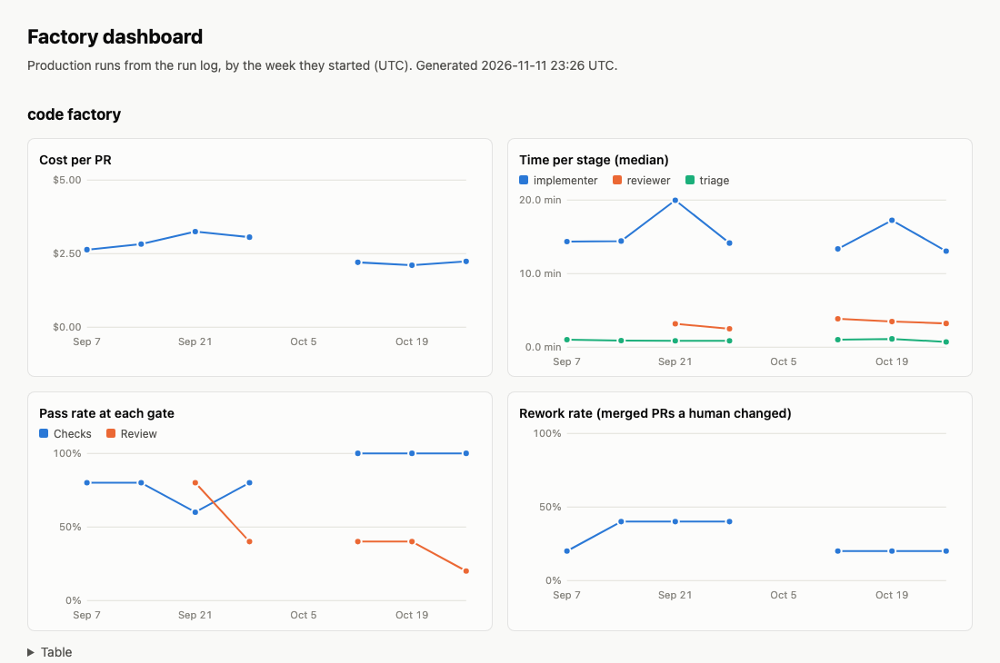

# 13: Cost and rework dashboard (TL-13)

## Expected

A page that reads the run log and shows four numbers per factory per week: cost per PR, time per stage, pass rate at each gate and rework rate. Each acceptance criterion maps to a mechanism:

| Acceptance | Mechanism |
| --- | --- |
| Dashboard reads the run log and renders per-week trends | `pnpm dashboard` reads ended production rows from `runs`, on SQLite or Postgres, and writes `.runlog/dashboard.html`: four line charts per factory over a gap-free week axis, and the same numbers as a table. |
| One documented example of a factory change that moved a metric | Needs live runs on both sides of a factory change. Not met by this PR; see below. |

## Happened

**A static page, not an app.** The page is one HTML file with inline SVG and no scripts, written by `platform/dashboard/dashboard.ts`, about 320 lines with no new dependency. A hosted dashboard would need a deploy, read access to Neon and authentication, and the numbers would be the same. `docs/ARCHITECTURE.md` records the choice and when to revisit it.

**Metrics are computed in TypeScript, not SQL.** The query is a plain `SELECT ... WHERE benchmark = ? AND status <> 'running'`, so it runs unchanged on both databases. Weeks are UTC Mondays, computed from `started_at`. Definitions, including what each one leaves out, are in `platform/dashboard/README.md`:

- **Cost per PR** charges failed runs to the PRs that shipped. A run that opened nothing still cost money, and a PR's real price includes its failed attempts. A week with spend and no PR has no cost per PR, so the table also shows each week's total cost and PR count.
- **Rework** is counted per PR, not per run. `rework` is set on every run of a PR, so counting runs would weight a PR by how many attempts it took.
- **"Pass rate at each gate"** is two gates, not one per check. The run log stores `checks_passed` (all gates passed) and `review_findings`, not which check failed. A review passes when it raised no findings, and any run with `review_findings` set counts as a review, so the dashboard hard-codes no role names.

**Postgres and SQLite give the same page.** The first comparison differed by about 10⁻⁸ px: Postgres stores `cost_usd` as `numeric(10,6)` and SQLite as a full float. Rounding SVG coordinates to 0.1 px removed the difference. It also cut the page from 18 KB to 16 KB.

*Synthetic data*: 95 seeded rows across three roles, with one empty week. It is not factory output; no factory has run yet.

**Code review changed five things before the PR** (`/code-review high`):

- **The dashboard no longer migrates.** It opened the run log through the writer's path, which applies pending migrations, so running it from a branch with a new `002_*.sql` would have changed the production schema. `openRunLog` takes a `readOnly` flag: no migrations, and SQLite opened read-only, so a missing file is an error instead of a new empty database. Rendering left the SQLite file byte-identical.
- **A week that spent money and opened no PR showed as a gap**, so the worst week could look like a week with no spend. The table now has total cost and PR count.
- **Role medians are a `Map`**, so a role named `constructor` cannot match `Object.prototype`.
- **The first and last weeks use `reduce`**, not `Math.max(...)` over every run, which throws past about 100,000 arguments.
- **`pnpm dashboard` with no run log says so** instead of printing SQLite's stack trace.

Five findings were left: a ninth role would have no colour (the roadmap has four roles); the per-week grouping rescans runs (milliseconds at this size); type conversion could move into `openRunLog` for every reader; the week list is held twice; and test temp directories are not removed, as in the run log's tests.

Checked before merge:

- **6 new unit tests** (`pnpm test`, 48 in all), on throwaway SQLite files:
  - Week boundaries: Sunday 23:59 UTC, Monday 00:00, and across a year end.
  - `readRuns` drops running and benchmark rows and converts SQLite's `1`/`0`.
  - A hand-computed week: two PRs, a failed run, two reviews and an empty week. Checks cost per PR ($7 over 2 PRs), per-role medians, both gate rates, and rework counted per PR. A later week with $4 spent and no PR keeps its total cost.
  - A read-only open of a missing SQLite file fails and creates nothing.
  - A role keeps its colour in a factory that lacks the roles sorted before it, and factory names are HTML-escaped.
  - An empty run log renders a page that says so.
- **Postgres 17 in Docker**, seeded with the same 95 rows: `readRuns` returned `Date`s, numbers and booleans, and the page matched the SQLite one byte for byte apart from the timestamp.
- **Rendered in Chrome**, light and dark, and at 390 px wide (no horizontal scroll). The palette is the first three slots of the dataviz reference palette, validated for colour-vision deficiency in both themes. One light-mode colour is below 3:1 contrast, which the table view covers.

Known gaps:

- **No real data.** The cloud run log has no factory rows: every `Factory` workflow run so far was skipped, because no issue has had `factory:ready` added since TL-12 merged.
- **The second acceptance criterion is open.** It needs a factory change with runs before and after it. The first real candidate is TL-7: moving the implementer prompt into `factories/code/agents/` and adding a reviewer should change cost per PR and give the review gate its first data. Its note should show the dashboard before and after.
- **Not published.** The page is generated on demand; nothing renders it from Neon on a schedule.
- **Cost of killed runs.** Their `cost_usd` is null, so a week with killed runs understates cost per PR.

## What the numbers said

| Measure | Value |
| --- | --- |
| Code | 1 file, about 320 lines, and a `readOnly` flag on `openRunLog`; no new dependency |
| Tests | 6 new; 48 pass |
| Code review findings | 10: 5 fixed, 5 left with reasons |
| Production rows in the cloud run log | 0 |
| Page size, 8 weeks × 3 roles | 16 KB |
| Pages from SQLite and Postgres that differed | 1 before rounding, 0 after |
| Factory change that moved a metric | None yet: needs live runs |
| Model cost of this stage | Not measured: built in an interactive session, not by the factory |
